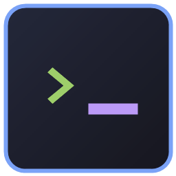
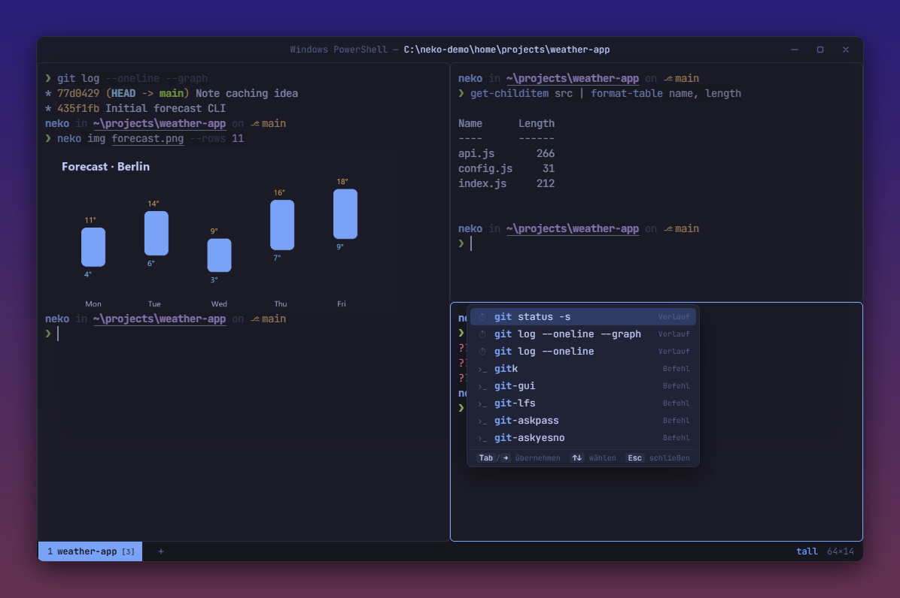
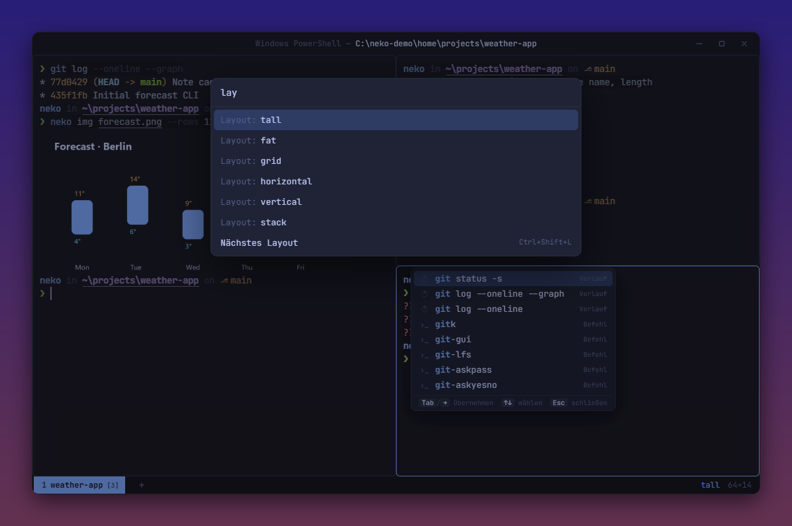
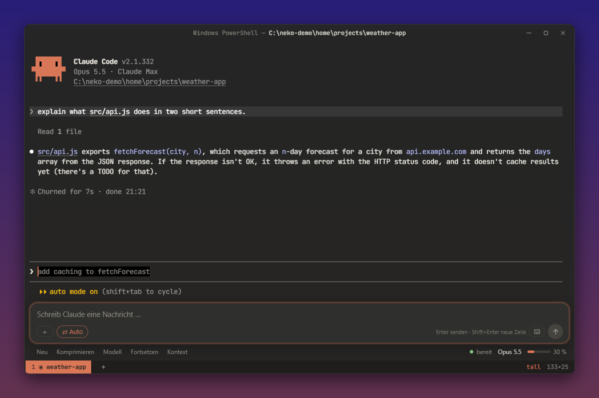
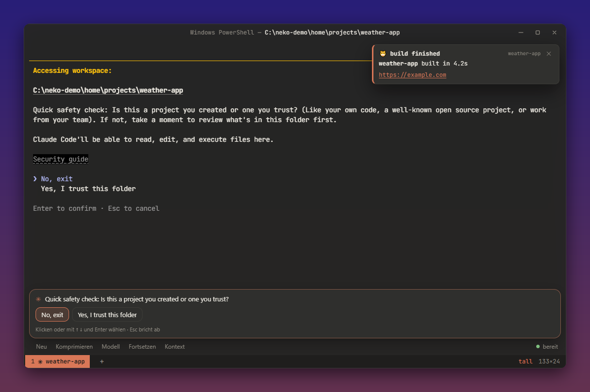

<div align="center">



# Neko Terminal

**A kitty-style terminal for Windows, macOS and Linux, built to work well with [Claude Code](https://claude.com/claude-code).**

Tiling layouts, inline images, popups, clickable paths, and a Claude mode that turns Claude Code's text UI into real buttons and an input box.

[**Download**](https://github.com/mehdi-ki/neko-terminal/releases/latest) · [Features](#features) · [Claude Code](#claude-mode) · [The `neko` command](#the-neko-command) · [Build from source](#build-from-source)

</div>



## Features

- **Kitty-style tiling.** Tabs and split panes with the layouts `tall`, `fat`, `grid`, `horizontal`, `vertical` and `stack`. Cycle them with `Ctrl+Shift+L`.
- **Autosuggest as you type.** Suggestions come from your history, the commands on your `PATH` and file paths. Accept with `Tab` or `→`.
- **Inline images.** Sixel, iTerm2 images (OSC 1337) and `neko img file.png`.
- **Popups, notifications and questions** from any script or from Claude Code (`neko popup`, `neko notify`, `neko ask`).
- **Clickable links and file paths.** `src/app.js:42` opens in VS Code or Cursor at that line.
- **Command palette** (`Ctrl+Shift+P`) for every action, layout and shell.
- **Themes:** Tokyo Night, Catppuccin Mocha, Gruvbox Dark, Nord, Rosé Pine, Kitty Classic and a Claude theme. Transparent window with adjustable opacity.
- **Any shell.** PowerShell, PowerShell 7, cmd, Git Bash and WSL on Windows. zsh, bash, fish and sh on macOS and Linux.
- **Paste images.** An image on the clipboard is saved as a PNG and pasted as a path, so Claude Code can read it.



## Claude mode

Start `claude` in a Neko pane and Neko switches into Claude mode:

- an app-like **input box** (multi-line, history, file picker) that types into Claude Code for you
- Claude's menus (permission prompts, `/model`, trust dialogs …) appear as **clickable buttons**
- a **status bar** with the model, how full the context is and what Claude is doing right now
- quick buttons for common commands (new chat, compact, model, resume, context)
- a **desktop notification** when Claude finishes or needs you while you are in another window





Neko learns Claude's state through [Claude Code hooks](https://docs.claude.com/en/docs/claude-code/hooks). These hooks only load when you start `claude` inside Neko, and Neko does not change your own Claude settings.

## The `neko` command

Every shell in Neko gets a `neko` command. It talks to the window over a local pipe, so it also works from scripts and from Claude Code's Bash tool:

```sh
neko img chart.png --rows 12          # show an image in the terminal
neko popup --title "Build" "**done** in 4.2s"   # popup card (markdown, links, images)
neko notify "Tests passed"            # notification (desktop notification when Neko is in the background)
neko ask --buttons "Yes,No" "Deploy?" # ask a question, prints the answer
neko progress 40                      # progress in the tab
neko open src/app.js:42               # open a file at a line, a URL or a folder
neko info                             # version and paths
```

Tip: tell Claude Code about it in your `CLAUDE.md`, for example *"Use `neko img` to show me images and `neko popup` for results."*

## Install

Download the file for your system from the [latest release](https://github.com/mehdi-ki/neko-terminal/releases/latest):

| System | File |
| --- | --- |
| Windows 10/11 | `NekoTerminal-…-windows-portable.exe` (portable, no install needed) |
| macOS (Apple Silicon / Intel) | `NekoTerminal-…-mac-arm64.dmg` / `…-mac-x64.dmg` |
| Linux | `NekoTerminal-…-linux-x86_64.AppImage` or `…-linux-amd64.deb` |

> [!NOTE]
> The builds are not code-signed yet.
> **Windows:** SmartScreen may warn you. Click *More info → Run anyway*.
> **macOS:** if macOS says the app is damaged or from an unidentified developer, run `xattr -cr "/Applications/Neko Terminal.app"` once.
> **Linux:** make the AppImage executable with `chmod +x NekoTerminal-*.AppImage`.

> [!NOTE]
> The interface is currently in German. Translations are welcome.

## Keyboard shortcuts

| Keys | Action |
| --- | --- |
| `Ctrl+Shift+T` / `Ctrl+Shift+Q` | new tab / close tab |
| `Ctrl+Shift+Enter` / `Ctrl+Shift+W` | split pane / close pane |
| `Ctrl+Shift+L` | next layout |
| `Ctrl+Shift+[` / `]` | previous / next pane |
| `Ctrl+Shift+←` / `→`, `Ctrl+Shift+1…9` | switch tabs |
| `Ctrl+Shift+P` | command palette |
| `Ctrl+Shift+H` | search |
| `Ctrl+Shift+=` / `-` / `Backspace` | font size |
| `Ctrl+Shift+Alt+↑` / `↓` | window opacity |
| `Ctrl+Shift+F2` | open the config file |
| `Ctrl+C` / `Ctrl+V` (`Cmd` on macOS) | copy selection / paste |

## Configuration

Settings live in `neko.json` (`Ctrl+Shift+F2` opens it, and changes apply right away):

| OS | Location |
| --- | --- |
| Windows | `%APPDATA%\neko-terminal\neko.json` |
| macOS | `~/Library/Application Support/neko-terminal/neko.json` |
| Linux | `~/.config/neko-terminal/neko.json` |

```json
{
  "theme": "Tokyo Night",
  "font_family": "JetBrains Mono",
  "font_size": 14,
  "background_opacity": 0.82,
  "shell": "",
  "claude_ui": true,
  "claude_theme": "Claude",
  "claude_notify": true
}
```

## Build from source

You need Node.js 20 or newer and git.

```sh
git clone https://github.com/mehdi-ki/neko-terminal.git
cd neko-terminal
npm install
npm start                    # run in development mode
npm run dist:release         # build installers for your system into dist/
```

**Live updates on Windows.** `npm run dist` builds a portable exe that loads its code from your clone. After that, `neko update` (`git pull` plus reload) brings in new code without a new exe. Your shells keep running.

Releases are built for all three systems by [GitHub Actions](.github/workflows/release.yml) when a `v*` tag is pushed.

## Built with

[Electron](https://www.electronjs.org/), [xterm.js](https://xtermjs.org/), [node-pty](https://github.com/microsoft/node-pty) (via [@lydell/node-pty](https://github.com/lydell/node-pty) prebuilds), [JetBrains Mono](https://www.jetbrains.com/lp/mono/). Inspired by [kitty](https://sw.kovidgoyal.net/kitty/).

Neko Terminal is an independent project and is not affiliated with Anthropic or kitty.

## License

[ISC](LICENSE)
